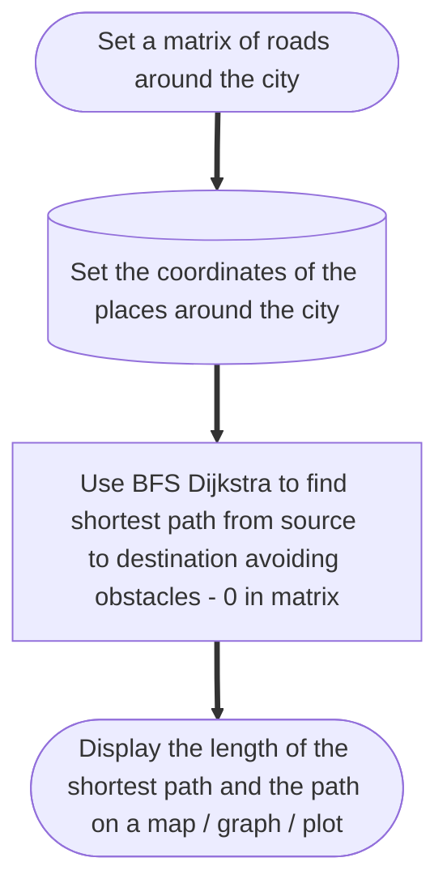

# Ward Queue

python -m pip install Flask && python app.py → open http://127.0.0.1:5000

- heap.py : indexed max-heap (sift-up/down, extract-max, remove, update) + hash map
- app.py : patient records (dict) + Flask API
- templates/ + static/ : frontend
  Ranking: higher urgency first, ties go to the earlier arrival.

# Hospital Ambulance Shortest Path Recommending System

### Algorithm

### Tests Run On Source Hospital - Dadar & 5 locations:

#### Source:

- Hospital at (0, 1)

#### Destinations:

- A at (0, 4)
- B at (9, 8)
- C at (0, 8)
- D at (8, 5)
- E at (3, 6)
