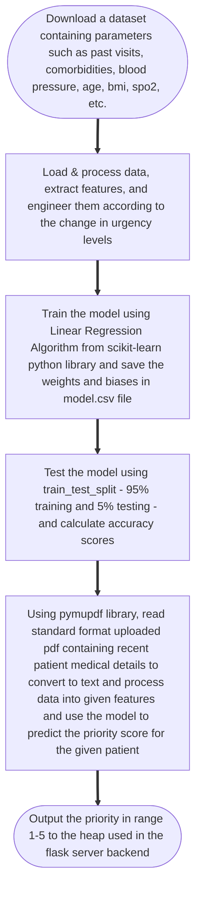
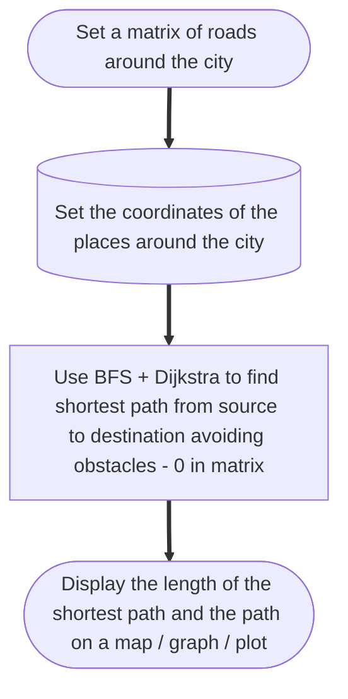

# Smart Hospital Management System - 1.0.0

Solves following problems:

- Assigns priority score based on severity of patient from his/her past medical details by reading PDF (1 --> Low severity --- 5 --> High severity)
- Automatically decides who doctor should attend to first
- Ambulance Shortest Path recommendation system works entirely offline and can be used in places with low reach of the internet

## Ward Queue (Max-Heap)

python -m pip install Flask && python app.py → open http://127.0.0.1:5000

- heap.py : indexed max-heap (sift-up/down, extract-max, remove, update) + hash map
- app.py : patient records (dict) + Flask API
- templates/ + static/ : frontend
  Ranking: higher urgency first, ties go to the earlier arrival.

## Smart Priority Assignment System Algorithm (Linear Regression + OCR)

## Ambulance Shortest Path Recommending System (BFS + Dijkstra)

### Tests Run On Source Hospital - Dadar & 5 locations:

#### Source:

- Hospital at (0, 1)

#### Destinations:

- A at (0, 4)
- B at (9, 8)
- C at (0, 8)
- D at (8, 5)
- E at (3, 6)

<h3 align='right'>Authored by: 

Ruturaaj Deshpande (SY B.Tech IT, VJTI 29')

Eashan Thakur (SY B.Tech IT, VJTI 29')

